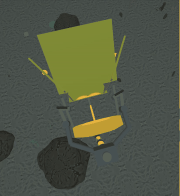
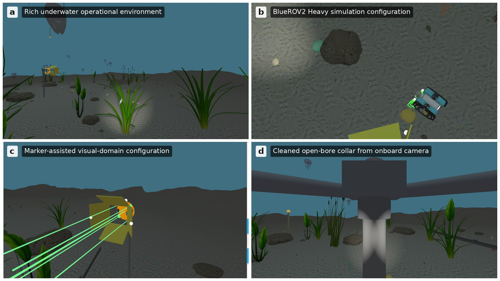
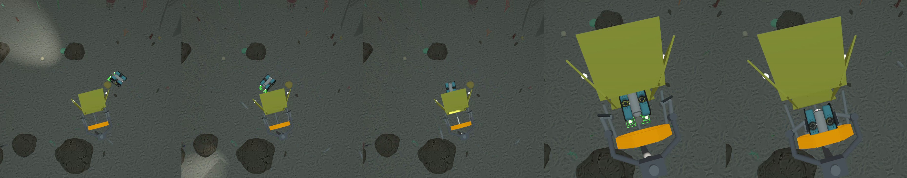
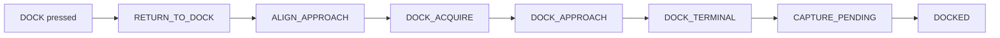

<div align="center">

# 🌊 Docking Station in AUV-Simulator

### An autonomous underwater docking station, with camera + sonar Transformer perception, for the AUV-Simulator




-orange)


</div>

---

## Overview

This repository adds a complete **autonomous docking station** to
[AUV-Simulator](https://github.com/Irlkidonu/AUV-Simulator), a ROS 2 / Gazebo underwater
simulator. A BlueROV2 Heavy finds the dock, approaches it, flies through a funnel into an
open-bore collar, and is physically captured by jaws and a latch. You can start the whole
sequence with one **DOCK** button, and you can make the water murkier or add current while
it runs.

The vehicle locates the dock with a small **Transformer** neural network that fuses the
onboard **camera** image and the **forward-looking sonar**. A terminal estimator then
combines that estimate with **DVL, IMU and depth**.

## Key features

- 🧠 **Camera + sonar Transformer**: about 1.2 M parameters, running in its own process.
- 🎯 **Terminal estimator/filter** that fuses perception with DVL, IMU and depth and rejects inconsistent updates.
- 🦾 **Physical docking station**: funnel, open-bore collar, collar **break-beam**, **capture jaws** and **latch**.
- ✅ **Honest "docked" signal**: `DOCKED` is declared only after the break-beam and the latch confirm capture.
- 🕹️ **One-button autonomy**, plus mission-complete and low-battery triggers that start the same docking sequence.
- 🌫️ **Live environment controls** for ocean current and modeled turbidity.
- 🐟 **Rich underwater scene** from AUV-Simulator: seabed, vegetation, fish, jellyfish, a wreck and a pipeline.
- 🔀 **Two dock styles**: `cleaned` (markerless, the default) and `marker_assisted` (green guidance beams).

## Screenshots

<div align="center">


*The underwater world, the BlueROV2 Heavy, the marker-assisted dock, and the markerless open-bore dock seen from the onboard camera.*



*Approach → funnel entry → throat → capture → jaws closed and latched.*
</div>

## Requirements

| Component | Version |
|---|---|
| OS | Ubuntu 24.04 |
| ROS 2 | Jazzy (desktop) with `ros-jazzy-ros-gz` |
| Gazebo | Gazebo Sim 8 (Harmonic), the ROS-vendored version installed with ROS 2 Jazzy |
| Python | 3.12 (system Python, used by ROS) |
| PyTorch environment | a separate Python virtual environment with `torch` and `numpy` (see `requirements.txt`) |
| GPU | recommended for smooth 3-D rendering; the Transformer runs on CPU |

## Installation

```bash
mkdir -p ~/docking_ws/src && cd ~/docking_ws/src

# 1. The simulator, at the commit this extension is built against
git clone https://github.com/Irlkidonu/AUV-Simulator.git auv-simulator
cd auv-simulator
git checkout "$(curl -fsSL https://raw.githubusercontent.com/Irlkidonu/Docking-Station-in-AUV-Simulator/main/simulator/BASE_COMMIT)"
cd ..

# 2. This repository
git clone https://github.com/Irlkidonu/Docking-Station-in-AUV-Simulator.git docking-station

# 3. Add the docking station to the simulator
cd auv-simulator
git apply ../docking-station/simulator/auv_simulator_docking.patch
cd ..

# 4. A Python environment for the Transformer
python3 -m venv ~/docking_ws/torch-venv          # needs: sudo apt install python3.12-venv
~/docking_ws/torch-venv/bin/pip install -r docking-station/requirements.txt
```

If `curl` isn't available, open `simulator/BASE_COMMIT` and check out the commit it lists.

## Build

```bash
cd ~/docking_ws
source /opt/ros/jazzy/setup.bash
colcon build --base-paths src/auv-simulator/src --packages-select uuv_mode_aware_navigation --symlink-install
```

### Environment (run in every new terminal)

```bash
source /opt/ros/jazzy/setup.bash
source ~/docking_ws/install/setup.bash
export DOCKING_STATION_ROOT=~/docking_ws/src/docking-station
export AUV_SIM_ROOT=~/docking_ws/src/auv-simulator
export DOCK_TORCH_PYTHON=~/docking_ws/torch-venv/bin/python
```

Optional:

| Variable | Default | Purpose |
|---|---|---|
| `DOCK_RUNTIME_ROOT` | `~/.cache/docking_station/runtime` | where the composed world and runtime traces are written |
| `DOCK_OUTPUT_ROOT` | `~/.cache/docking_station` | where session recordings are written |
| `DOCK_ROS_DOMAIN_ID` | `43` | ROS domain, which keeps the demo separate from other ROS sessions |

## Launch

```bash
ros2 launch uuv_mode_aware_navigation playground_docking.launch.py dock_variant:=cleaned gui:=true panel:=true
```

| Argument | Values | Meaning |
|---|---|---|
| `dock_variant` | `cleaned` (default), `marker_assisted` | markerless open-bore dock, or the dock with green guidance beams |
| `gui` | `true` / `false` | open the Gazebo window (use `false` for headless runs) |
| `panel` | `true` / `false` | open the control panel |

Allow 15–30 seconds for the world, the sensor bridges, the Transformer server and the panel to
start. Closing the Gazebo window ends the session.

## Controls

The control panel opens next to Gazebo:

- **DOCK** starts autonomous docking from wherever the vehicle is.
- **Thrusters and attitude** let you drive the vehicle by hand before docking (keyboard: `w/s` forward/back, `a/d` strafe, `r/f` up/down, `q/e` yaw, `space` stop).
- **Ocean current** sets the speed and bearing of the current.
- **Modeled turbidity** makes the water clearer or murkier (presets from *Clear* to *Severe*).

Once **DOCK** is pressed, the autonomy owns the vehicle until docking ends.

## Docking workflow



1. The vehicle navigates back toward the station.
2. The Transformer locks onto the dock using the camera and the sonar.
3. The terminal estimator keeps the dock-relative estimate stable into the funnel.
4. The collar **break-beam** must see the vehicle three times in a row (about 0.1 s).
5. The vehicle holds still, the **jaws close**, and the **latch** attaches; only then does the state become `DOCKED`.

Touching the funnel is allowed, because the funnel guides the vehicle in. Hitting the collar
rim or the support structure ends the run as `CRASHED`.

## Turbidity and current controls

Use the panel, or publish from a second terminal (with the environment set up as above):

```bash
# ocean current (m/s)
ros2 topic pub --once /uuv/set_current geometry_msgs/msg/Vector3 "{x: 0.10, y: 0.0, z: 0.0}"

# modeled turbidity (a simulation setting, not a calibrated NTU value)
ros2 topic pub --once /uuv/scenario_hold std_msgs/msg/Bool "{data: true}"
ros2 topic pub --once /uuv/set_modeled_turbidity std_msgs/msg/Float32 "{data: 0.8}"

# other ways to start docking
ros2 topic pub --once /uuv/autonomy_request std_msgs/msg/String "{data: DOCK}"
ros2 topic pub --once /uuv/mission_complete std_msgs/msg/Bool "{data: true}"
ros2 topic pub --once /uuv/soc_fraction std_msgs/msg/Float32 "{data: 0.199}"
```

Remember to `export ROS_DOMAIN_ID=43` (or your `DOCK_ROS_DOMAIN_ID`) in that terminal.

## Project structure

```
docking-station/
├── docking_perception/     Transformer model, sonar/camera encoders, perception servers,
│                           terminal providers and docking-world composition
├── tools/                  runtime processes started by the launch file:
│   ├── docking_supervisor.py   docking state machine and terminal estimator
│   ├── perception_server.py    Transformer inference server
│   ├── vehicle_bridge.py       powered BlueROV2 Heavy bridge
│   ├── operator_camera.py      onboard camera view with modeled water
│   └── session_recorder.py     session recording
├── models/                 trained Transformer weights (cleaned and marker-assisted docks)
├── worlds/                 docking-station model (funnel, collar, jaws, latch, break-beam)
├── simulator/              patch that adds the docking station to AUV-Simulator, plus its base commit
├── test/                   smoke tests
└── docs/                   images used in this README
```

## Testing

Run these in a terminal **without** ROS sourced; the tests don't need ROS.

```bash
cd ~/docking_ws/src/docking-station
export AUV_SIM_ROOT=~/docking_ws/src/auv-simulator
~/docking_ws/torch-venv/bin/pip install pytest
PYTEST_DISABLE_PLUGIN_AUTOLOAD=1 ~/docking_ws/torch-venv/bin/python -m pytest test -q
```

The smoke tests check that the package imports, that both model files load and produce
finite estimates, and that the docking world can be composed.

## Troubleshooting

| Symptom | Fix |
|---|---|
| `environment variable DOCKING_STATION_ROOT is not set` | Run the *Environment* block in that terminal. |
| `another docking-station launch is already active` | Close the other session. If none is running, delete `/tmp/docking_station_playground.lock`. |
| `Transformer socket unavailable` | Check `DOCK_TORCH_PYTHON` points at the virtual environment with `torch` installed. |
| `git apply` fails | Make sure `auv-simulator` is checked out at the commit in `simulator/BASE_COMMIT` and has no local changes. |
| Gazebo opens but the scene is grey or slow | Use a GPU driver; on NVIDIA + Mesa systems, the launch file already selects the NVIDIA EGL vendor. |
| Topics don't show up from a second terminal | Use the same `ROS_DOMAIN_ID` as the launch (default `43`). |
| The vehicle doesn't move after DOCK | Wait until the panel telemetry is updating before pressing DOCK; startup takes 15–30 s. |

## License

The original code in this repository is released under the [MIT License](LICENSE).
Third-party components are covered by their own licenses; see
[THIRD_PARTY_NOTICES.md](THIRD_PARTY_NOTICES.md).

---

<div align="center">

**Simulation only.** Built on [AUV-Simulator](https://github.com/Irlkidonu/AUV-Simulator) · ROS 2 Jazzy · Gazebo Sim 8

</div>
